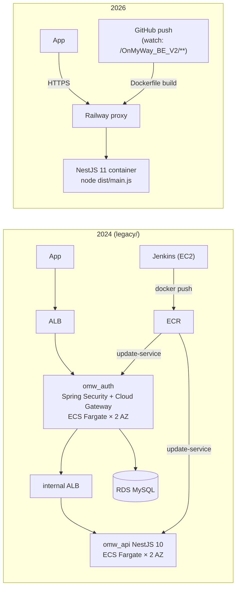

# Design Document — Backend Runtime & Container Deployment

## Overview

The deployment got smaller on purpose. The 2024 ECS setup (two services, internal ALB, NAT, Bastion,
RDS, Jenkins on EC2) was built to learn high availability during an internship and then to try Kubernetes.
For a stateless API in front of Kakao and Google, one container with a health check and fast rollback is
enough. The cost and moving parts now match the product.

## Before → after



## Image

```dockerfile
FROM node:22.13.0-alpine AS build      # pinned pnpm, frozen lockfile, build, prune --prod
FROM node:22.13.0-alpine AS runtime    # package.json + node_modules + dist only
USER node
HEALTHCHECK … wget http://127.0.0.1:${PORT}/health
CMD ["node", "dist/main.js"]
```

pnpm is installed with `npm install --global pnpm@10.15.1` instead of Corepack, because the Corepack in this
Node image can hold stale registry signing keys and reject newer pnpm releases.

## Railway configuration

| Setting | Value | Why |
| --- | --- | --- |
| Builder | `DOCKERFILE` | Same image locally and in production |
| Watch paths | `/OnMyWay_BE_V2/**` | No API redeploy for FE or docs commits |
| Health check | `/health`, 120 s | New deployment must be healthy before it replaces the old one |
| Restart | `ON_FAILURE`, max 10 | Restart crashes only |
| Variables | API keys, Swagger credentials | `.env` is never uploaded. `PORT` comes from Railway |

### Recommended starting resources (not yet applied as limits)

| Environment | CPU | Memory | Replicas | Sleep |
| --- | --- | --- | --- | --- |
| Preview | 0.5 vCPU | 512 MB | 1 | allowed |
| Production | 1 vCPU | 1 GB | 1 | **off** (no cold start for mobile) |
| After growth | 2 vCPU | 2 GB | 1 → 2 | off |

Scale up when CPU stays above 70% for 10–15 min or memory above 75%. If latency is high with headroom
left, check provider latency and quotas before adding replicas. Every replica multiplies provider API spend.

## Error handling and rollback

- Unhealthy deployment → stays on the previous deployment.
- Bad release → redeploy the previous successful deployment in Railway and pause the app release.
- Logs never include coordinates, raw queries or provider payloads, so they can be shared during an incident.

## Testing strategy

| Level | What |
| --- | --- |
| Build | `pnpm build`, Docker image build |
| Tests | 5 unit suites, `/health` e2e |
| Live | `GET https://<production-origin>/health` → `200 {"success":true,"data":"ok"}` |
| Open | production smoke of every endpoint, metrics baseline, external uptime monitor |
