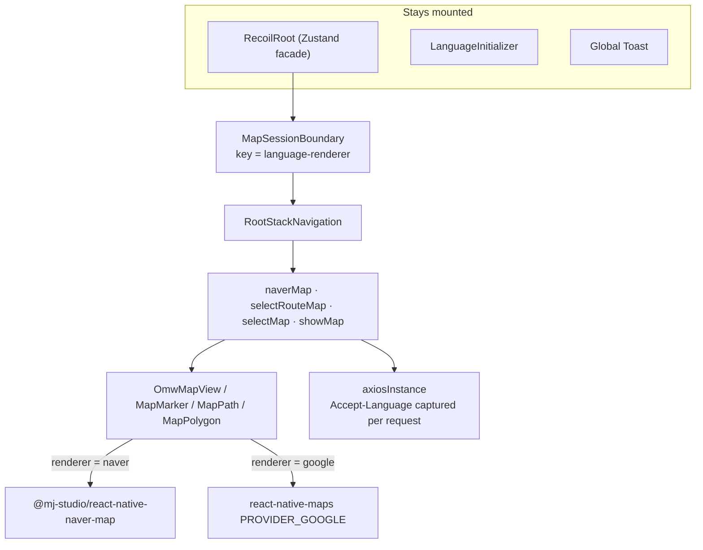
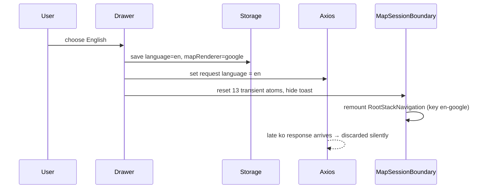

# Design Document — Bilingual Experience & Map Renderers

## Overview

Two independent user settings, **language** and **renderer**, share one reset boundary. Language decides
UI text and the backend data provider (through `Accept-Language`). Renderer decides only which native map
SDK draws tiles. Both are persisted in AsyncStorage and both remount the same navigation subtree.

## Architecture

## Language switch sequence

## Components

| File | Role |
| --- | --- |
| `src/i18n/dictionaries.ts` | Typed flat `ko` / `en` dictionaries with interpolation |
| `src/hooks/useTranslation.ts` | Language-aware translate hook |
| `src/hooks/useResetMapSession.ts` | Resets transient atoms and toasts |
| `src/api/axios.ts` | Captures language at request start, discards stale responses |
| `src/components/maps/omwMapView.tsx` | Renderer switch and Google → Naver camera event adapter |
| `src/components/maps/mapPrimitives.tsx` | `MapMarker`, `MapPath`, `MapPolygon` for both SDKs |
| `src/atoms/mapRendererState.ts`, `src/config/mapRenderer.ts` | Renderer state and defaults |
| `patches/react-native-maps@1.29.0.patch` | iOS Fabric custom-marker size sync |

## Renderer differences and how they are bridged

| Difference | Bridge |
| --- | --- |
| Google has no path outline | Two polylines: outline below, main line on top. Same colors, width and z-index contract |
| Google marker press bubbles to the map press | Stop propagation on marker events. Forward only real background presses to `onMapClick` |
| Google camera events differ | Compute zoom and covering region in `onRegionChangeComplete` and emit the Naver shape |
| iOS Fabric mounts marker PNG children after wrapper layout | Patch the Fabric wrapper to sync the legacy marker / `iconView` size after layout **and** after child mount, then redraw |

### iOS custom marker investigation

The default purple Google pin rendered but custom PNG children did not, so coordinates, conditional
rendering and marker registration were ruled out. Reading `AIRGoogleMapMarker` showed that custom children
are inserted into an internal `iconView` that the Google SDK rasterizes. Under Fabric the child image mounts
*after* the wrapper's layout, so size propagation at layout time alone could miss it. The fix is a
persistent pnpm patch. A dry run against the original package and an offline frozen-lockfile reinstall
confirm it reapplies cleanly.

## Error handling

- Stale-language responses are a typed cancellation, swallowed by API wrappers.
- Location failure → no native map, translated retry UI.
- Missing Google key → only Google tiles are disabled. The Naver renderer and the data APIs keep working.

## Testing strategy

| Level | What |
| --- | --- |
| Static | ESLint, `tsc --noEmit`, diagnostics |
| Unit | App preference hydration and root render smoke test |
| Native | Android `assembleDebug` with injected manifest keys, iOS simulator build with injected plist keys |
| Visual (open) | Both renderers × iOS/Android: marker size and anchor, z-index, route outline, bottom sheet behaviour |
