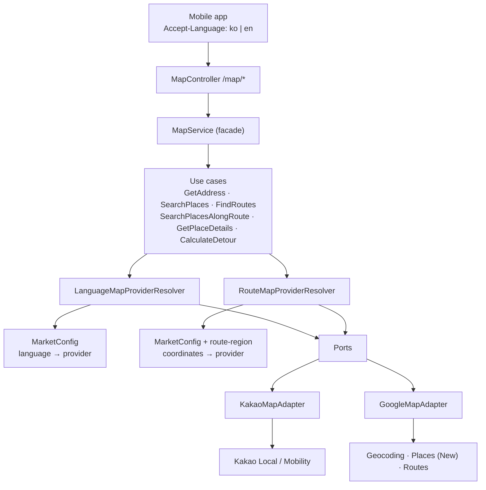
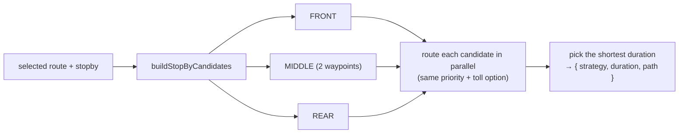

# Design Document — Provider-Neutral Map Engine

## Overview

Two decisions shape the design. **Search** follows the user's language. **Routing** follows the
coordinates, because Google does not provide driving directions in Korea. Everything else (ports,
resolvers, error model) exists so that these two policies stay in one declarative place
(`MarketConfig`) and never leak into use cases or adapters.

## Architecture



## Components

| File | Responsibility |
| --- | --- |
| `providers/map-provider.port.ts` | Neutral models (`Coordinate`, `PlaceResult`, `RouteResult`, `StopByRouteResult`) and the five ports |
| `providers/map-request-context.ts` | `Accept-Language` → `MapRequestContext` |
| `providers/market-config.ts` | Declarative policy: language → provider per feature, coordinates → route provider, units, region hint |
| `providers/route-region.ts` | Korea routing geofence (mainland polygon + island boxes) and coordinate validation |
| `providers/language-map-provider.resolver.ts` | Picks the adapter for geocoding and search |
| `providers/route-map-provider.resolver.ts` | Picks the adapter for routes and stopby |
| `providers/map-provider.error.ts` | `MapProviderException` and the stable public codes |
| `providers/route-not-found.error.ts` | Internal marker for Google's successful empty `routes` |
| `providers/stop-by-candidates.ts` | `FRONT` / `MIDDLE` / `REAR` insertion candidates, shared by both adapters |
| `providers/polyline.ts` | Encoded polyline (precision 1e5) for Google Search Along Route |

## Decision table

| Condition | Address / place / along-route | Route / stopby | Fallback |
| --- | --- | --- | --- |
| `ko`, `ko-*` | Kakao | by coordinates | none |
| other / missing | Google | by coordinates | none |
| any point in Korea | (language policy) | Kakao only | none |
| all points abroad | (language policy) | Google only | none |

## Along-route search algorithms

```text
route polyline
  → sample vertices from radius and route length
  → search around each vertex in parallel
  → drop results outside the radius
  → dedupe by provider place id
  → boost places found from several vertices
  → cap by route length
```

- **Kakao:** keyword or category search per sampled vertex with `x, y, radius`. Partial failures are tolerated. Too few successful vertices fails the request.
- **Google:** same sampling helper, at most 10 vertices, Text Search with `locationBias.circle`, Haversine post-filter at `radius × 1.25`, repeat-hit priority, `nextPageToken` up to 3 pages when results are short.

## Stopby



## Data models

Excerpt from `providers/map-provider.port.ts`:

```ts
type ProviderId = 'GOOGLE' | 'KAKAO' | 'TMAP' | 'NAVER';   // TMAP / NAVER reserved for future adapters
type ProviderFieldStatus = 'KNOWN' | 'UNKNOWN' | 'UNSUPPORTED';

interface ProviderAttribution { provider: ProviderId; url?: string }

interface PlaceResult {
  provider: ProviderId;
  provider_place_id?: string;
  attribution: ProviderAttribution;
  place_name?: string;
  address_name: string;
  road_address_name?: string;
  place_url?: string;
  place_id?: string;            // Google only, used for place-detail
  open?: boolean;
  scoreAvg?: number;
  commentCnt?: number;
  x: number;                    // longitude
  y: number;                    // latitude
}

interface PlaceDetailResult {
  provider: ProviderId;
  attribution: ProviderAttribution;
  field_status: PlaceDetailFieldStatus;   // one ProviderFieldStatus per optional field
  id: string;
  open: boolean | null;                   // null = UNKNOWN, never false
  opening_hours: string[] | null;
  parking: boolean | null;
  rating: number | null;
  rating_count: number | null;
}
```

## Error handling

| Situation | Result |
| --- | --- |
| Invalid coordinate | `400 Invalid route coordinate`, no provider call |
| Google 429 / quota | `MAP_PROVIDER_QUOTA_EXCEEDED` (503) |
| Google 401 / 403 | `MAP_PROVIDER_AUTHENTICATION_FAILED` |
| Timeout | `MAP_PROVIDER_TIMEOUT` (504) |
| 5xx / network | `MAP_PROVIDER_UNAVAILABLE` |
| Required route field missing | `MAP_PROVIDER_INVALID_RESPONSE` |
| Google `200` with empty `routes` | `RouteNotFoundError` → no-route for that provider. Kakao is **not** called |
| Kakao, all three priorities fail | error, not an empty list |

## Testing strategy

| Level | What |
| --- | --- |
| Unit | controller, service, exception filter, logger middleware (Jest) |
| e2e | `/health` |
| Geofence smoke | Seoul, Jeju, US, Japan, mixed Korea/abroad waypoints |
| Live (localhost) | `ko-KR` Seoul reverse geocode via Kakao, `en-US` US reverse geocode via Google, place detail with `parking: null` kept as UNKNOWN |
| Planned | provider-neutral contract suite run against both adapters |
