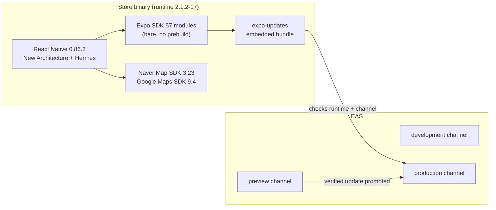
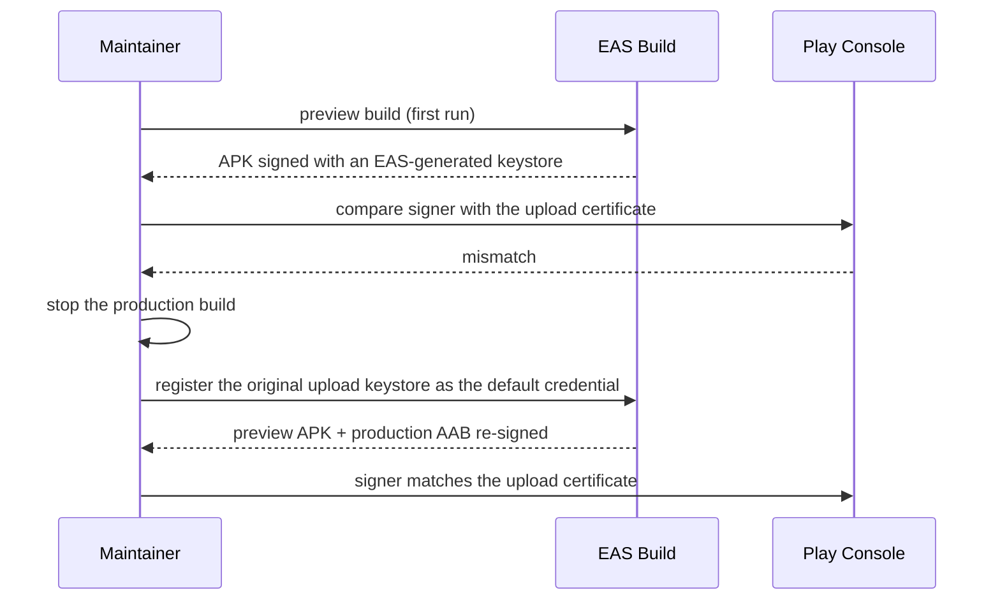

# Design Document — React Native 0.86 Platform Migration

## Overview

The migration rebuilds the native shell and keeps the product code. A new React Native 0.86 bare
template is generated, `src/` is ported into it, and every native integration is re-applied by hand:
maps, keys, splash, signing, and now Expo modules for OTA. Store identity and signing are treated as
immutable inputs, not as configuration to regenerate.

## Architecture

## Dependency mapping

| Before (0.73.6) | After (0.86.2) | Reason |
| --- | --- | --- |
| `react-native-code-push` + `appcenter*` | `expo-updates` + EAS Update | App Center retired on 2025-03-31 |
| `react-native-nmap` (community fork) | `@mj-studio/react-native-naver-map` 2.9.0 | Fork does not support the New Architecture |
| — | `react-native-maps` 1.29.0 (Google provider) | Google renderer for English / overseas use |
| `recoil` 0.7 | Zustand 5 behind a Recoil-shaped facade | Recoil is unmaintained. The facade avoids touching every screen |
| NativeWind 2 | NativeWind 4 (Tailwind 3.4) | v2 does not support RN 0.86 |
| React Navigation 6 | React Navigation 7 | Compatibility |
| `react-native-splash-screen` | `react-native-bootsplash` 7 | Unmaintained |
| TMap native SDK + bridges | `tmap://` URL handoff | No credentials in the binary, no native bridge to maintain |

## Key decisions

### New template instead of in-place upgrade

Thirteen minor versions plus the New Architecture changed most of `android/` and `ios/`. CodePush removal
and the map library swap required re-doing native setup anyway, so a clean template with ported `src/`
had less risk than a diff-by-diff upgrade.

### Manual Expo integration

`install-expo-modules@0.16.0` did not recognize React Native 0.86.2, so Expo SDK 57 was integrated with
the official manual bare-workflow steps. A prebuilt-core AppDelegate header mismatch was resolved with
the source fallback (`RCT_USE_PREBUILT_RNCORE=0`). Existing Metro and Babel settings (SVG transformer,
dotenv, NativeWind, Reanimated) were merged, not replaced.

### Explicit runtime version

The local and cloud fingerprints differed, so the `fingerprint` policy was dropped in favour of an
explicit runtime version. The rule becomes procedural: any native change bumps the build number and the
runtime version together.

### Signing guard

### OTA code signing deferred

End-to-end update signing requires the EAS Production plan ($199/month). There are no accounts, payments
or B2B contracts yet, so the release relies on Expo 2FA, minimal publish rights, preview-first promotion,
runtime isolation and rollback. Signing can be added later only with a new binary (the certificate has to be embedded).

## Error handling

- Missing `SERVER_BASEURL` in a production build fails fast at startup with a configuration error.
- OTA failures must fall back to the embedded bundle (gate in Requirement 6).

## Testing strategy

| Level | What |
| --- | --- |
| Static | `lint`, `typecheck`, no `@ts-*` suppressions, `no-console` |
| Unit | Jest smoke test for App render and preference hydration |
| Native compile | Android `:app:bundleRelease`, iOS unsigned generic simulator build |
| Artifact | Manifest and plist identity, version/build, update metadata, embedded bundle origin, signer |
| Device (open) | Runtime smoke matrix, OTA recovery rehearsal |
