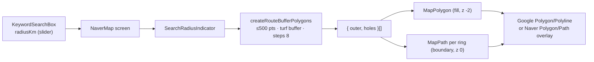

# Design Document — Route Corridor Search & Waypoints

## Overview

The previous corridor was a very wide, semi-transparent route line whose pixel width approximated the km
radius. It drifted with zoom, looked different on each SDK and covered map labels. The new corridor is
real geometry: the route is buffered in kilometres, filled at ~8% alpha and outlined with thin rings.
Waypoint insertion candidates are now built by one helper shared by the Kakao and Google adapters.

## Corridor rendering pipeline



| Token | Value |
| --- | --- |
| `fillColor` | `#F552A814` |
| `searchBoundaryColor` | `#F552A84D` |
| `searchBoundaryWidth` | `1` |
| `outlineWidth` / `outlineColor` | `0` / `transparent` (prevents Naver's default black outline) |
| `zIndex` | fill `-2`, boundary `0`, route and markers above |

The corridor is a visualization of the search radius, not a guarantee. Results come from sampled vertices
and provider-side bias, so a valid result can sit slightly outside the drawn area.

### Display states

| State | Corridor | Markers |
| --- | --- | --- |
| Route selected, before search | shown | hidden |
| Slider moving | updated (debounced) | hidden |
| Request in flight | shown | hidden |
| Results shown | hidden | shown |
| "Search again" | shown | cleared |
| Route changed or cleared | removed | removed |

## Waypoint insertion

```text
waypoints = []          → [stopby]                               FRONT
waypoints = [A]         → [stopby, A] | [A, stopby]              FRONT, REAR
waypoints = [A, B]      → [stopby, A, B] | [A, stopby, B] | [A, B, stopby]
                                                                 FRONT, MIDDLE, REAR
each candidate → route with the same priority + avoid option (Promise.allSettled)
result         → min(duration) → { strategy, duration, path }
```

`buildStopByCandidates` keeps the FE waypoint wire format (`" | "` separated) so the contract did not change.

## External navigation

| Route region | Button | Target |
| --- | --- | --- |
| any point in Korea | Naver Map | `nmap://route/car` app scheme (store fallback) |
| all points abroad | Google Maps | universal URL, ordered `waypoints`, `travelmode=driving`, `dir_action=navigate`, optional `avoid=tolls` |

Google is hidden for Korean routes because Google Maps cannot provide driving directions there, which
would send the user into a dead end. The universal URL needs no API key and falls back to the browser.
Two existing waypoints plus the selected place (3 total) stays within the mobile waypoint limit.

## Known gaps

- The slider can display 20.5–25 km while the payload is clamped to 20 km.
- The along-route payload is still loosely typed on the FE, and DTO descriptions differ from the actual validation.
- A direction arrow at the route end (`MapDirectionalPath`) has been evaluated but not built.

## Testing strategy

| Level | What |
| --- | --- |
| Static | ESLint, typecheck, `git diff --check` |
| Audit | Compare against `release/v2.1.2` to confirm no radius UI or payload regression |
| Visual (open) | 1 / 3 / 20 km corridors on both renderers, closed rings, no false connectors, label readability |
